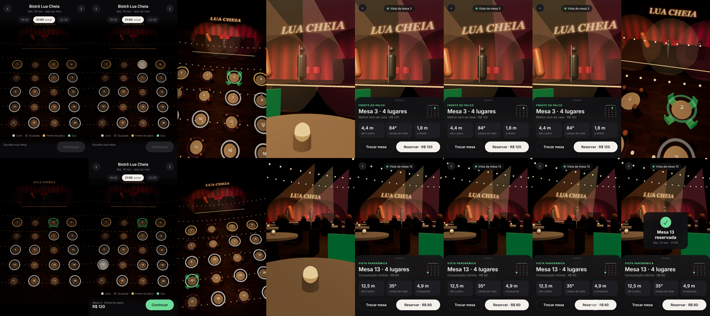

# vista-3d

Skill para Claude Code que monta um app 3D de **"escolha seu lugar vendo a vista antes de reservar"** para qualquer negócio com lugares marcados: restaurante com palco, bar com show, cinema, teatro, auditório.

Mapa 3D visto de cima → toca na mesa → a câmera voa até aquele lugar e mostra a distância do palco, o ângulo de visão e o preço → reserva.

## Instalar

Copie esta pasta para `~/.claude/skills/vista-3d/` e peça ao Claude Code:

> Usa a skill vista-3d e monta o app pro meu restaurante: 18 mesas, palco no fundo, frente do palco R$ 120.

## Usar sem Claude

1. Abra `assets/vista-3d.html` num editor e troque o bloco `window.VENUE` (nome, horários, zonas, preços, mesas).
2. Rode `python -m http.server` na pasta e abra no navegador. `?demo` roda a demonstração sozinha.
3. Para gravar em vídeo 1080x1920: `python scripts/capture.py assets/vista-3d.html app.mp4` (precisa de `pip install playwright`, Chrome e ffmpeg).

Feito por [@astro_lipenation](https://www.instagram.com/astro_lipenation/).
